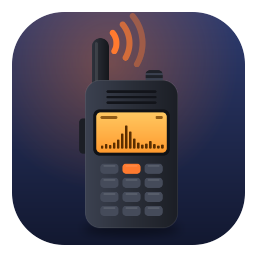

<p align="center">
    <a href="https://github.com/ERuban/k5k1prog-mac/releases/latest"></a>
</p>

<h1 align="center">K5K1 Prog</h1>

<p align="center">Back up, restore and flash Quansheng UV-K5 / UV-K5 V3 / UV-K1 radios on macOS</p>

<p align="center"><a href="https://eruban.github.io/k5k1prog-mac/">eruban.github.io/k5k1prog-mac</a></p>

<p align="center">
  <a href="README_RU.md">Русский</a> |
  <a href="README_ES.md">Español</a> |
  <a href="README_DE.md">Deutsch</a> |
  <a href="README_ZH.md">中文</a>
</p>

<div align="center">

[](https://github.com/ERuban/k5k1prog-mac/releases/latest)
[](https://boosty.to/eruban/donate)

[](https://github.com/ERuban/k5k1prog-mac/releases/latest)


[](LICENSE)
[](https://github.com/ERuban/k5k1prog-mac/actions/workflows/tests.yml)
[](https://github.com/ERuban/k5k1prog-mac/releases)

</div>

<br />

macOS port of **k5prog-win v0.1.26** (OneOfEleven), with improvements.

A native macOS app to back up, restore and flash **Quansheng UV-K5 / UV-K5(8) / UV-K6 / UV-5R Plus**
(V1, DP32G030) and **UV-K5 V3 / UV-K1** (PY32F071) radios over a programming cable.

It keeps the behaviour of [k5prog-win](https://github.com/OneOfEleven/k5prog-win) one to one (same
buttons, same log, same bytes on the wire) and adds firmware upload for the newer UV-K5 V3 and UV-K1,
which k5prog-win can't do, a channel editor, plus a few safety fixes
(see [Differences from k5prog-win](#differences-from-k5prog-win)).

## Features

- **Read / write calibration** (512 bytes at `0x1E00`). Back up your radio's factory calibration
  before you flash anything.
- **Read / write configuration** (channels and settings, `0x0000–0x1CFF`).
- **Write firmware**, raw `.bin` or vendor `.packed.bin`. The radio type is detected from the image
  itself and checked against the bootloader before anything is written.
- **Memory Editor** for the radio's 200 channels, stock and Karina firmware, UV-K5 V1 and UV-K1 /
  UV-K5 V3 (see [Edit channels](#edit-channels)): edit, copy and drag channels between two radios,
  import / export CHIRP CSV and CHIRP `.img`, power-on text on stock firmware. Writes only the changed
  channels, after a backup, and reads them back to verify. Settings and calibration are never touched.
- **Radio status** in the main window: which radio is on the cable, in which mode, and its firmware
  string, checked quietly every 2 seconds.
- **Settings** (**K5K1 Prog → Settings…**): light / dark appearance, the folder for the editor's
  backups.
- Universal app (Apple Silicon and Intel), macOS 12 or newer. No drivers or extra software needed
  for CH340 cables.
- Settings (port, speed, verbose level, window position, appearance) are kept the macOS way, in
  `~/Library/Preferences/io.github.eruban.k5k1prog.plist`. Nothing is written next to the app.

## Supported radios

| Radio | MCU | Bootloader | Calibration / config | Firmware |
|---|---|---|---|---|
| UV-K5, UV-K5(8), UV-K6, UV-5R Plus ("V1") | DP32G030 | 2.x – 4.x | ✅ | ✅ (k5prog-win protocol) |
| UV-K5 V3, UV-K1 | PY32F071 | 7.xx (7.00.07 or newer) | ✅ | ✅ |
| UV-K5 V2, UV-K6 V2 | PY32F030 | 1.xx | ✅ | ❌ refused |

The model is printed under the battery (V2, V3), but the bootloader version is the reliable sign: put the
radio in bootloader mode and press **Write Firmware**, the log shows `Bootloader version '…'`.
UV-5R Plus Type-C radios with bootloader 5.x use an encrypted bootloader protocol and are not supported.

Tested on real hardware: a UV-K5 V1 (bootloader 2.00.06) and a UV-K1 (bootloader 7.03.01). Both were
flashed with K5K1 Prog, calibration and configuration were read from both, and calibration was
written to the UV-K1 and verified by reading it back.

> [!WARNING]
> Firmware for V1, V2 and V3/K1 radios is **not interchangeable**. K5K1 Prog checks this before it
> sends anything: a V1 image on a 7.xx bootloader, a V3/K1 image on any other bootloader, and any
> image on a V2 bootloader (1.xx) are refused.
>
> It **can't tell a UV-K1 image from a UV-K5 V3 image** (same chip, same bootloader, and the
> bootloader does not report the model). Pick the file for your model. If you flash the wrong one,
> the radio can misbehave or not start, but the bootloader is not overwritten: switch the radio on
> with **PTT** held and flash the right file.
>
> Flashing is at your own risk.

## Install

With [Homebrew](https://brew.sh):

```sh
brew install --cask eruban/tap/k5k1-prog
```

`brew upgrade` installs new versions (the cask in [ERuban/homebrew-tap](https://github.com/ERuban/homebrew-tap)
follows every release by itself).

Or download `K5K1-Prog-<version>.dmg` from [Releases](../../releases), open it and drag **K5K1 Prog**
to **Applications**. The app is signed with a Developer ID and notarized by Apple, so it opens
without warnings. A `.zip` with the same app is attached too.

From version 1.1.0 on the app updates itself: it checks GitHub for a new release once a day (and on
**K5K1 Prog → Check for Updates…**), shows what's new and installs it with one click
([Sparkle](https://sparkle-project.org), updates are EdDSA-signed). Version 1.0.0 has no updater, so
install 1.1.0 by hand once.

Or build from source (needs the Xcode Command Line Tools, Swift 5.9 or newer):

```sh
git clone <this repository> k5k1prog-mac && cd k5k1prog-mac
./scripts/build_app.sh        # -> "K5K1 Prog.app" in the repository root (ad-hoc signed)
open "K5K1 Prog.app"
```

## Usage

Connect the radio with a programming cable (2-pin Kenwood plug). The cable shows up as
`/dev/cu.usbserial-…` (or `/dev/cu.wchusbserial…` with the WCH driver installed). Select it in **Serial port** and keep
**38400 - k5/k6**.

### Back up first

1. Switch the radio on normally.
2. **Read Calibration** and save the file somewhere safe. It holds your radio's own TX power and
   battery calibration, and you can't get it back anywhere else.
3. **Read Configuration** and save.

Calibration and configuration are written back the same way (**Write Calibration**,
**Write Configuration**), with the radio switched on normally.

### Flash firmware

1. Switch the radio off, hold **PTT** and switch it on. The screen stays blank: the radio is in
   bootloader mode.
2. **Write Firmware** and choose the `.bin` (or `.packed.bin`) for your model.
3. Check the log: `Bootloader version '…'` starts with `2`–`4` on V1 radios and with `7` on V3/K1.
4. Wait for `write FLASH complete`. The radio restarts with the new firmware.

Then follow the instructions of your firmware (memory reset, which calibration files to load, and so
on). Some firmware packages ship a complete calibration file that replaces your factory TX power and
battery values. Compare a fresh **Read Calibration** with your backup afterwards.

### Edit channels

1. Switch the radio on normally, select its port and press **Memory Editor…** (⌘E). The channels are
   read from the radio; the window always shows what is in the radio now.
2. **Firmware** and **Radio** are picked from the radio's firmware string: stock firmware by its
   version number, Karina by her codename. Karina's string is the same on the UV-K5 V1 and the UV-K1,
   so the editor asks which radio it is, once. A firmware it does not know opens read-only until you
   choose. If you choose something the firmware string contradicts, the editor says so in red: the
   channel values (mode, step, scrambler) would be read and written wrongly.
3. Double-click a cell to edit it. Select several channels to change them together, **Set Power**,
   **Delete**, ⌘Z to undo.
4. **Write to Radio…** lists the changes, saves a backup of the radio's configuration
   (`~/Documents/K5K1 Prog Backups/`, see Settings), checks that the radio has not changed since it
   was read, writes only the changed blocks, reads them back and compares. Restore a backup with
   **Write Configuration**.

Copy channels to another radio: open an editor for each radio (one per port) and drag the channels
across or use Copy / Paste, or **Export Channels…** on one and **Import Channels…** on the other.
Values that the other firmware does not have (USB on stock firmware, Karina's scrambler list, fine
steps) are converted and listed. An import keeps the channel numbers; settings in the file are
ignored. Formats: CHIRP CSV, CHIRP `.img` (stock or Karina, UV-K5 / UV-K1), and a configuration
`.bin` from Read Configuration (a `.bin` doesn't say which radio it is from: choose it in the import
dialog).

The editor checks the radio every 2 seconds while its window is active. If another radio is plugged
in, it reads that one (or, with unwritten edits, says so and does not write to it).

Only the channel memory is edited (200 channels, the stock layout that stock firmware, Karina and
F4HWN share). Other firmware, more than 200 channels (F4HWN on the UV-K1) and the radio's settings
are not supported.

## Differences from k5prog-win

All on the safe side:

1. **UV-K5 V3 / UV-K1 firmware upload** (PY32F071, bootloader 7.xx), see below.
2. A V1 (DP32G030) firmware file is never sent to a 7.xx bootloader, and firmware upload to a
   UV-K5 V2 / K6 V2 (bootloader 1.xx, PY32F030) is refused: V1 firmware leaves such a radio with a blank
   screen.
3. **Configuration file whose size is not a multiple of 128 bytes.** k5prog-win reads past the end of
   its buffer and writes random memory into the radio. Here the rest of the last block keeps the
   radio's own bytes (read back first). Normal files (7424 / 8192 / 512 bytes) are not affected.
4. The port list shows `/dev/cu.*` (the macOS equivalent of the COM port list). The status bar has
   no "RX BREAK" indicator.
5. The main window does not query the radio into the log on start-up and on a port change ("Fetching
   radio details .. radio not detected"). The radio status is shown in the status bar instead, and
   the buttons follow it: configuration, calibration and the editor need the radio in normal mode,
   Write Firmware needs it in firmware update mode, nothing is enabled without a radio. Long log
   lines wrap.
6. **Settings** are kept in macOS preferences (`io.github.eruban.k5k1prog`), not in an ini file next
   to the app: on a Mac that folder is `/Applications`. The keys are the ones of `k5prog_win.ini`
   (`MainForm.Top`, `GUI.Verbose`, `SerialPort.Name`, …). Versions 1.0 / 1.1 used `K5K1Prog.ini`; it is
   imported once and deleted. File dialogs start in `~/Documents`.

Everything else matches the original: buttons, order of operations, timeouts (hello 2×1 s, read 3 s,
write 2 s, flash 3 s), retries, checks, every log line and message box text, the protocol (frames,
XOR tables, CRC, session id `6A 39 57 64`, 128-byte config blocks, 256-byte flash blocks, the
bootloader version fix-up `4.00.07` → `*.00.07`), the settings keys and Esc to abort a transfer.

## UV-K5 V3 / UV-K1 firmware upload

**Write Firmware** detects the file type by its vector table: a PY32F071 image has its reset vector
at `0x080xxxxx`, a DP32G030 image at `0x0000xxxx`. Raw `.bin` and vendor `.packed.bin` files are
accepted for both. V1 files keep the unchanged k5prog-win path.

PY32 protocol (as in muzkr's serialtool):

- the bootloader must start with `7` and be `7.00.07` or newer, otherwise nothing is sent;
- 5 valid `0x0518` beacon intervals (5–1000 ms) in a row, then `0x0530` with the first 4 characters
  of the bootloader version, once per beacon, 3 times;
- `0x0519` pages: time stamp LE32, page LE16, page count LE16, 4 × `00`, 256 data bytes (the last
  page padded with `00`); answer `0x051A` time stamp / page / error; 3 s per page, up to 3 re-sends
  of a page after an error or a missing answer;
- maximum image size `0x1D800` (application area at `0x08002800`, 118 KB);
- no reboot command at the end, the bootloader starts the new firmware itself.

Wrong combinations are refused before anything is written: a V1 file on a 7.xx bootloader, a V3/K1
file on any other bootloader, any file on a V2 bootloader (1.xx), a bootloader older than 7.00.07, a
too large image, a radio that is not in bootloader mode.

## Development

Contributions are welcome: see [CONTRIBUTING.md](CONTRIBUTING.md) (and [AGENTS.md](AGENTS.md) for AI
coding agents).

```sh
swift test                    # 76 tests: simulator, protocol, reference comparisons, channels
swift run k5emu --mode boot --bl-version 7.03.01 --link /tmp/k5com   # simulated K1 bootloader
```

- `Sources/K5Core`: protocol, firmware file handling, the k5prog-win logic; `Channels.swift` and
  `ChannelTransfer.swift` for the Memory Editor (channel layout, profiles, CSV / `.img`).
- `Sources/K5K1Prog`: the AppKit app.
- `docs/`: the website (GitHub Pages, five languages), generated by `scripts/build_site.py`; edit the
  texts there and run it.
- `scripts/chirp-golden/golden.py`: builds the channel test references with the real CHIRP drivers
  (synthetic images, no personal data). Only needed when the profiles change.
- `Sources/K5Sim`, `Sources/k5emu`: a UV-K5 simulator on a pseudo terminal. User mode, V1 bootloader,
  and `--bl-version 7.xx.xx` for the PY32 bootloader. Fault injection for rejected or lost pages in
  `RadioSim.Options`.
- The tests need no firmware files: firmware uploads (V1 and PY32, raw and `.packed`) use synthetic
  images with a valid vector table.
- GitHub Actions (`.github/workflows/tests.yml`) builds, runs the tests and builds the app bundle on
  every push and pull request.

Release: bump `K5.version` in `Sources/K5Core/Constants.swift`, write `release-notes/<version>.md`,
then `./scripts/release.sh`. It runs the tests, builds the universal app, signs it and the embedded
Sparkle framework with the "Developer ID Application" certificate (hardened runtime), notarizes and
staples the app and the `.dmg`, signs the update `.zip` with the Sparkle EdDSA key and writes
`dist/` (`.dmg`, `.zip`, `appcast.xml`, `SHA256SUMS.txt`, `RELEASE_NOTES.md`). Attach all of them
to the GitHub release: installed copies read `releases/latest/download/appcast.xml`. One-time setup
(notarytool profile, Sparkle key in `Resources/SparklePublicKey.txt`) is in the script header. The
script publishes nothing.

Test hooks (not needed for normal use):

- `K5PROG_EXTRA_PORTS=/tmp/k5com` adds device paths to the port list (for `k5emu --link /tmp/k5com`).
- `K5PROG_UITEST=readcalib,writecalib,quit` with `K5PROG_UITEST_OPEN/SAVE/MEMO` drives the real app
  without dialogs (also `editor`, `editor-import`, `editor-write`, `editor-export`, `snap` with
  `K5PROG_UITEST_SNAP=<dir>` for window snapshots, `wait`; full list in [AGENTS.md](AGENTS.md)).
- `K5PROG_BACKUP_DIR=<dir>` puts the Memory Editor's backups there.
- `K5PROG_CHANNEL_DUMPS=<dir>` compares the channel decode of your own dumps with CHIRP's
  (`<name>.<profile>.bin` + `golden.py --decode` output as `.json`).
- `K5PROG_SETTINGS_SUITE=<name>` keeps the settings of a dev / test run apart from the real ones
  (and skips the import of an old `K5K1Prog.ini`).
- `K5PROG_SPARKLE_FEED=<url>` points the updater at another appcast (local update tests,
  `open --env K5PROG_SPARKLE_FEED=… "K5K1 Prog.app"`).

## Support

K5K1 Prog is free. If it saved your radio or your time, you can
[**Donate**](https://boosty.to/eruban/donate) (via Boosty). Tips pay for the Apple Developer account that keeps the
app signed and notarized, and for testing on real radios.

## Credits

- K5K1 Prog by [Evgeny Ruban](https://github.com/ERuban).
- [k5prog-win](https://github.com/OneOfEleven/k5prog-win) by OneOfEleven, the program this app is a
  port of (GPL v3).
- [k5prog](https://github.com/sq5bpf/k5prog) by Jacek Lipkowski SQ5BPF, whose radio communication
  routines k5prog-win is built on (GPL v3).
- UV-K5 V3 / UV-K1 bootloader protocol as implemented by muzkr's serialtool in
  [armel/uv-k1-k5v3-firmware-custom](https://github.com/armel/uv-k1-k5v3-firmware-custom).
- Channel layout and value lists of the Memory Editor follow the [CHIRP](https://github.com/kk7ds/chirp)
  drivers: UV-K5 by Jacek Lipkowski SQ5BPF, UV-K1 by Thibaut Berg, and Karina's CHIRP modules by
  M2Boo (based on the egzumer / JOC2 / F4HWN drivers), GPLv2 or later. CSV and `.img` are CHIRP's
  formats.

## License

GPL v3, same as k5prog-win and k5prog. See [LICENSE](LICENSE). Copyright © 2026 Evgeny Ruban.

K5K1 Prog is a modified version of k5prog-win: the C++/VCL Windows program was rewritten in Swift for
macOS, and UV-K5 V3 / UV-K1 firmware upload, the Memory Editor and the safety fixes listed above were
added (2026).

This software is not affiliated with Quansheng. Transmit only on frequencies and at power levels you
are licensed for.
